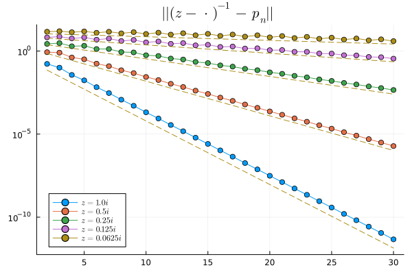

The following argument is contained in @Benzi2013.

::: {#prp-combes-thomas}
## Combes--Thomas estimate for banded matrices
Suppose $H$ is banded: $H_{\ell k} = 0$ for all $r_{\ell k} \geq m$. Then, for $z \notin \sigma(H)$,
$$
\left| (z - H)^{-1}_{\ell k} \right| \lesssim e^{-\frac{\eta}{m} \, r_{\ell k}},
\qquad \text{where } \eta \sim \mathrm{dist}\big( z, \sigma(H) \big).
$$
:::

::: {.proof}
Since $H_{\ell k} = 0$ for all $r_{\ell k} \geq m$, we have

$$
\begin{align}
    [H^n]_{\ell k} = \sum_{\ell_1,\dots,\ell_{n-1}} H_{\ell \ell_1} H_{\ell_1\ell_2} \cdots H_{\ell_{n-1} k} = 0
\end{align}
$$

for all $r_{\ell k} \geq nm$.

Therefore, for all $n \leq \frac1m r_{\ell k}$, we have

$$
\begin{align}
    \left| (z - H)^{-1}_{\ell k} \right|
    %
    &= \inf_{P_n \in \mathcal P_n} \left| \left[ (z - H)^{-1} - P_n(H) \right]_{\ell k} \right| \nonumber\\
    %
    &\leq \inf_{P_n \in \mathcal P_n} \left\| (z - \cdot)^{-1} - P_n \right\|_{L^\infty(\sigma(H))}
    \nonumber\\
    %
    &\lesssim e^{-\eta \, n}  \approx e^{-\frac{\eta}m \, r_{\ell k} }
\end{align}
$$

where $\eta \sim \mathrm{dist}\big( z, \sigma(H) \big)$.
:::

::: {#exm-chebyshev-resolvent}
Here, we let $p_n$ be the polynomial interpolation of $x \mapsto (z - x)^{-1}$ on Chebyshev nodes $\{ \cos \frac{j\pi}{n} \}_{j=0}^n$ and plot the $L^\infty$ error on $[-1,1]$ for different choices of $z$ (this gives an upper bound on the locality of the resolvent as above):

This is $O(e^{-\eta \, n})$ decay with

| $\mathrm{dist}(z, \sigma(H))$ | $\eta$ |
|---:|---:|
| 1.0 | 0.880853 |
| 0.5 | 0.479982 |
| 0.25 | 0.24404 |
| 0.125 | 0.116845 |
| 0.0625 | 0.0505203 |

i.e. it roughly halves when the distance to the “spectrum” is halved.
:::

