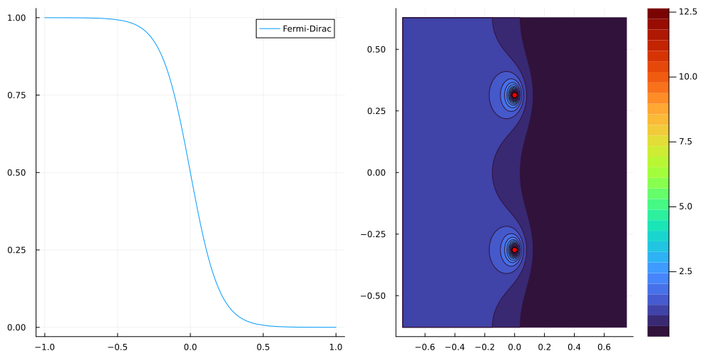
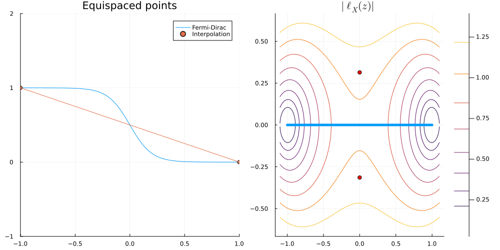
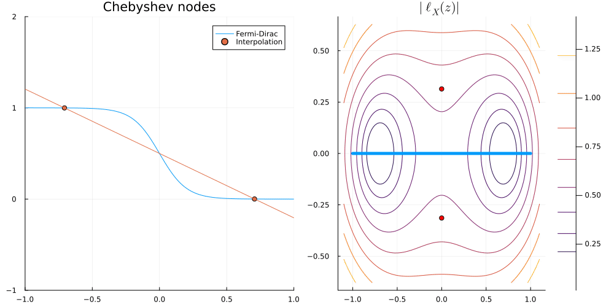
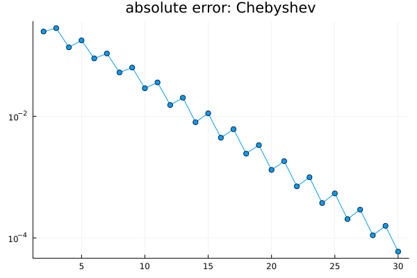
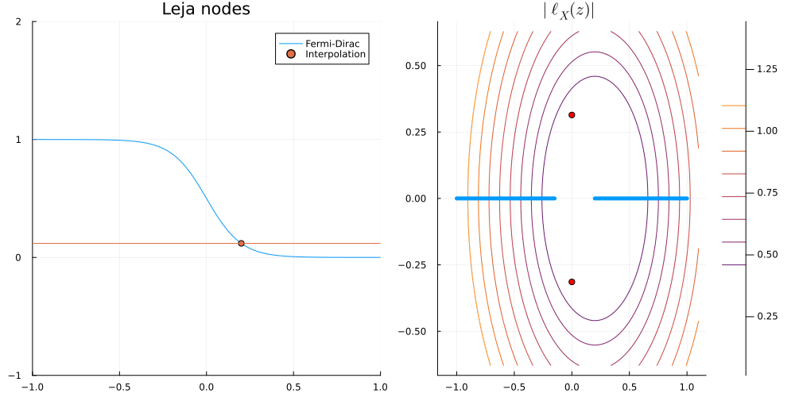
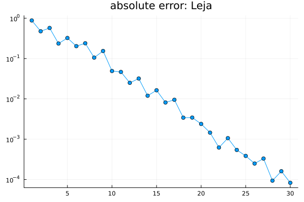

Given at:

- September 2025 -- [Group meeting](#group-meeting-2025)
- October 2023 -- [Journée de rentrée de l'équipe, IHES](#ihes-2023)

## Group meeting (September 2025) {#group-meeting-2025}

- Based on @ThomasChenOrtner2022:body-order,
- [slides](slides-group-meeting-2025.pdf)
- [slides - quadrature](quadrature.pdf)
- [notes](notes.pdf)



### Equispaced nodes



### Chebyshev nodes



``` julia
 plt3 = plot( 2:N, err[2:N], marker=:circle, yaxis=:log, title="absolute error: Chebyshev", legend=false)
```



### What about approximation on $[-1, a] \cup [b, 1]$?

Leja points:




``` julia
plot( 1:N, err, marker=:circle, yaxis=:log, title="absolute error: Leja", legend=false)
```



## Journée de rentrée de l'équipe, IHES (October 2023) {#ihes-2023}

- [IHES](https://www.ihes.fr/en/) -- [programme](programme-ihes-2023.pdf)
- Based on @ThomasChenOrtner2022:body-order

<iframe class="pdf-embed" src="slides-ihes-2023.pdf#navpanes=0&pagemode=none&view=FitH"></iframe>

[\[open fullscreen\]](slides-ihes-2023.pdf)
