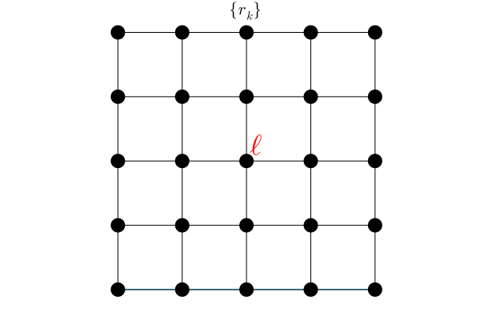
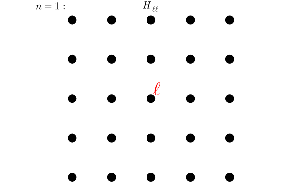
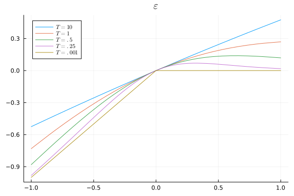
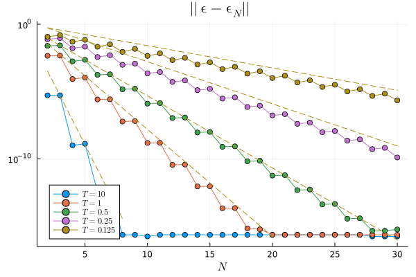
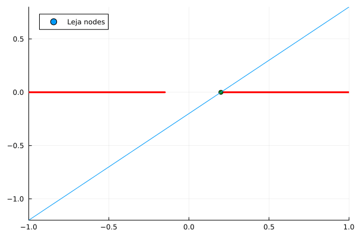
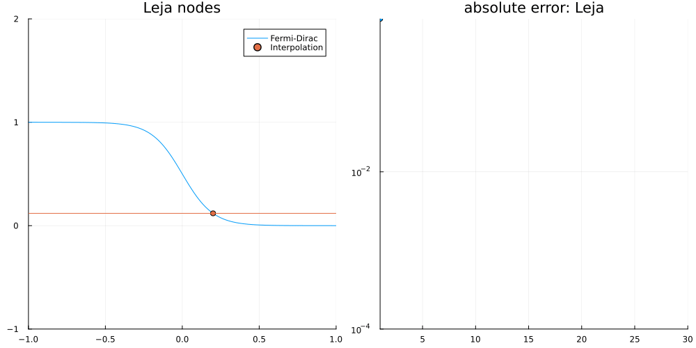

Given at:

- December 2025 -- [PDE Seminar, University of Minnesota](#umn-2025)
- June 2023 -- [Problèmes Spectraux en Physique Mathématique, Institut Henri Poincaré](#ihp-2023)

## PDE Seminar, University of Minnesota (December 2025) {#umn-2025}

::: {.callout-note collapse="true"}
### Abstract

Computational methods, such as density functional theory, have been used successfully to model electronic structure and thus allowed the investigation and prediction of properties of molecules and materials. However, even now, the high computational cost of these methods severely limits their applicability in material modelling to thousands of atoms for static and hundreds of atoms for long-time dynamic simulations.

On the other hand, in practice, one may bypass the electronic structure model entirely and replace it with a surrogate interatomic potential, a functional form which is designed to remain computationally tractable but also capture a minimal subset of desired properties of the system of interest. Empirical interatomic potentials are computationally inexpensive and can thus be used for large-scale, long-time dynamic simulations, for example. However, the simplicity of these parametric models limits their accuracy and transferability.

A continuous increase in the complexity of parameterisations has naturally led to machine-learned interatomic potentials (MLIPs), where one learns the parameters in the model via a fitting procedure. In this talk, we will survey some recent results on the sparsity of the potential energy landscape aimed to justify and extend the theory of MLIPs.

Joint work with Huajie Chen and Christoph Ortner.

:::

- Mostly based on @ThomasChenOrtner2022:body-order

<iframe class="pdf-embed" src="slides-umn-2025.pdf#navpanes=0&pagemode=none&view=FitH"></iframe>

[\[open fullscreen\]](slides-umn-2025.pdf)

### Resolvent estimates: Proof by polynomial approximation

The following argument is contained in @Benzi2013:

::::: columns
::: column
\
\
\

Suppose that $H$ is a nearest neighbour (NN) Hamiltonian:

$$
\begin{align}
    H_{\ell k} = 0 \qquad \text{for all } r_{\ell k}  > 1.
\end{align}
$$

Since

$$
\begin{align}
    [H^2]_{\ell k} &= \sum_{\ell_1} H_{\ell \ell_1} H_{\ell_1 k}  \\
    [H^3]_{\ell k} &= \sum_{\ell_1 \ell_2} H_{\ell \ell_1} H_{\ell_1 \ell_2} H_{\ell_2 k} \\
    [H^4]_{\ell k} &= \sum_{\ell_1 \ell_2 \ell_3} H_{\ell \ell_1} H_{\ell_1 \ell_2} H_{\ell_2 \ell_3} H_{\ell_3 k}
\end{align}
$$

etc., we have $[H^n]_{\ell k} = 0$ for all $r_{\ell k} > n$.
:::

::: column

:::
:::::

Therefore, we can bound the off-diagonal decay of functions of the Hamiltonian: e.g. if $r_{\ell k} > n$, then

$$
\begin{align}
    \left| (z - H)^{-1}_{\ell k} \right|
    %
    &= \inf_{P \in \mathcal P_n} \left| \left[ (z - H)^{-1} - P( H) \right]_{\ell k} \right| \nonumber\\
    %
    &\leq \inf_{P \in \mathcal P_n} \left\| (z - \cdot)^{-1} - P \right\|_{L^\infty(\sigma(H))}
    \nonumber\\
    %
    &\lesssim e^{-\eta \, n}  \approx e^{- \eta \, r_{\ell k} }
\end{align}
$$

where $\eta \sim \mathrm{dist}\big( z, \sigma(H) \big)$.

::: {#exm-chebyshev-resolvent}
Here, we let $p_n$ be the polynomial interpolation of $x \mapsto (z - x)^{-1}$ on Chebyshev nodes $\{ \cos \frac{j\pi}{n} \}_{j=0}^n$ and plot the $L^\infty$ error on $[-1,1]$ for different choices of $z$ (this gives an upper bound on the locality of the resolvent as above):

This is $O(e^{-\eta \, n})$ decay with

| $\mathrm{dist}(z, \sigma(H))$ | $\eta$ |
|---:|---:|
| 1.0 | 0.880853 |
| 0.5 | 0.479982 |
| 0.25 | 0.24404 |
| 0.125 | 0.116845 |
| 0.0625 | 0.0505203 |

i.e. it roughly halves when the distance to the “spectrum” is halved.
:::

### Polynomials are body-ordered

### Approximating $\varepsilon(z) = zF(z)$ on $[-1,1]$

 

This is $O(e^{-\eta n})$ with

| $T$ | $\eta$ |
|---:|---:|
| 10.0 | 4.20986 |
| 1.0 | 1.83189 |
| 0.5 | 1.23431 |
| 0.25 | 0.720808 |
| 0.125 | 0.382578 |

### Leja points

Using these points to approximate $F(x) = (1 + e^{10 x})^{-1}$ on $[-1, -.15] \cup [.2,1]$, we get:

## Problèmes Spectraux en Physique Mathématique, IHP (June 2023) {#ihp-2023}

- Seminar: [Problèmes Spectraux en Physique Mathématique](https://www.imo.universite-paris-saclay.fr/~stephane.nonnenmacher/tournant/seminairetournant.html), Institut Henri Poincaré

<iframe class="pdf-embed" src="slides-ihp-2023.pdf#navpanes=0&pagemode=none&view=FitH"></iframe>

[\[open fullscreen\]](slides-ihp-2023.pdf)
