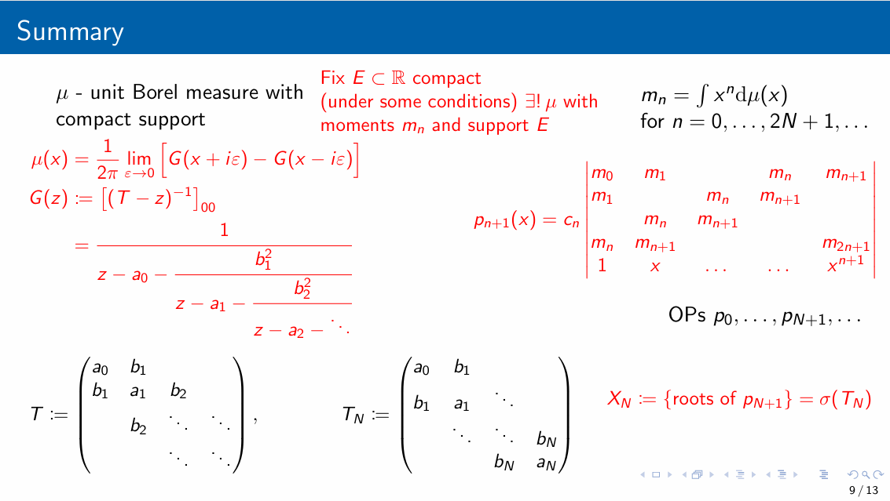

- Mostly from @ThomasChenOrtner2022:body-order [paper](arma.pdf) and the references
- Also see [slides](Quadrature.pdf)

References

- Bond-order potentials (BOP): @Drautz2020, @Finnis2007, @Horsfield1996, @Pettifor1989
- Numerical BOP: @Haydock1972, @Turchi1982, @Haydock1985, @Luchini1987
- Kernel polynomial method: @Silver1994,
- Quadrature-based methods: @Nex1978, @Suryanarayana2013, @Haydock1984
- Maximal entropy method: @Glanville1988, @Mead1984

(also see @ThomasChenOrtner2022:body-order (section 4.3 and Appendices D, E, F))

TO-DO: understand:

- @Chin2010: [Exact mapping between system-reservoir quantum models and semi-infinite discrete chains using orthogonal polynomials](https://arxiv.org/pdf/1006.4507)
- @Woods2014: [Mappings of open quantum systems onto chain representations and Markovian embeddings](https://arxiv.org/pdf/1111.5262)
- @Saberi2008 [Matrix product state comparison of the numerical RG and the variational formulation of the DMRG](https://arxiv.org/pdf/0804.0193)

## Orthogonal polynomials

We have some measure $\mu$ and we want to consider sequences of orthogonal polynomials: $P_n \in \mathcal P_n$ (polynomials of degree $\leq n$) such that $\mathrm{deg} P_n = n$ and

$$
\begin{align}
    (P_n, P_m) := \int P_n(x) P_m(x) \mathrm{d}\mu(x) = 0
    \nonumber
\end{align}
$$

for all $n\not=m$.

We have a choice of normalisation:

- Orthonormal polynomials: $(P_n, P_m) = \delta_{mn}$,
- Monic orthogonal: $P_n = x^n + ...$,
- e.g., $P_n(1) = 1$,
- ….

::: {#exm-classical-ops}
## Classical orthogonal polynomials

Suppose $\mathrm{d}\mu(x) = w(x) \mathrm{d}x$:

- *Jacobi*: $w(x) = (1-x)^\alpha (1+x)^\beta$ on $[-1,1]$,
- *Gegenbauer*: Jacobi with $\alpha=\beta$,
- *Legendre*: $w(x) = 1$ on $[-1,1]$ (Jacobi and Gegenbauer with $\alpha=\beta=0$),
- *Chebyshev*: Jabobi with $\alpha = \beta = -\frac{1}{2}$ (first kind), $\alpha=\beta=+\frac12$ (second kind),
- *Hermite*: $w(x) = e^{-x^2}$ on $\mathbb R$,
- *Laguerre*: $w(x) = x^\alpha e^{-x}$ on $[0,\infty)$.

:::

Why?

- The above polynomials appear all over the place,
- Gauss quadradure (uses the zeros of orthogonal polynomials to approximate integrals),
- Approximation theory,
- …..

::: {#exm-spectral-measures}
## Spectral measures

For $A$ bounded self-adjoint operator, there exists a unique *spectral measure* $\mu_i$ such that

$$
\begin{align}
    f(A)_{ii} = \int f(x) \mathrm{d}\mu_i(x).
\end{align}
$$

When $A$ is a matrix, with eigenpairs $(\lambda_j, v_j)$, then $\mu_i = \sum_j |[v_j]_i|^2 \delta_{\lambda_j}$.

:::

When $A$ is e.g. a tight binding Hamiltonian, the corresponding spectral measure $\mu_i$ is a *local density of states (LDOS)*. We can use orthogonal polynomials (and the corresponding Jacobi operator) to approximate the LDOS.

## Jacobi operators

Question: How to generate the sequence of orthogonal polynomials?

Answer: Lanczos-type recursion (it turns out that orthogonal polynomials satisfy a three-term recursion relation).

::: {#exm-chebyshev}
## Chebyshev polynomials

For example, we have Chebyshev polynomials of the first kind satisfy $T_0(x) = 1$, $T_1(x) = x$, and

$$
\begin{align}
    T_{n+1} = 2x T_n(x) - T_{n-1}(x)
\end{align}
$$

(Chebyshev II have the same recursion but with $U_0 = 1, U_1 = 2x$.)

:::

For simplicity, let’s suppose that $\mu(\mathbb R) = 1$ and generate the sequence of orthonormal polynomials. We first define $P_0(x) = 1$ and $b_1 P_1(x) = x - a_0$. For $P_1$ to be orthogonal to $P_0$, we require $a_0 = \int x \mathrm{d}\mu$ and we choose $b_1$ so that $\int P_1^2 \,\, \mathrm{d}\mu = 1$. Then, supposing we have $a_1,b_1, \dots, a_n,b_n$, then we define

$$
\begin{align}
    &b_{n+1} P_{n+1}(x) := (x-a_n) P_n(x) - b_n P_{n-1}(x) \qquad \text{with} \nonumber\\
    %
    &\int P_{n+1}(x)^2 \mathrm{d}\mu(x) = 1 \quad \text{and} \quad
    %
    a_{n+1} := \int x P_{n+1}(x)^2 \mathrm{d}\mu(x)
\end{align}
$$

::: {#lem-three-term}
This recursion generates the sequence of orthonormal polynomials.
:::

::: {.proof}
By the choice of $a_0$ we have $(P_0, P_1) = 0$ and, by the choice of $b_1$, we have $(P_1,P_1)=1$. We assume that $P_0,\dots,P_n$ are orthonormal with respect to $\mu$, and note that

$$
\begin{align}
    b_1 &= b_1 \int P_1(x)^2 \mathrm{d}\mu \nonumber\\
    %
    &= \int (x-a_0) P_1(x) \mathrm{d}\mu = \int xP_0(x) P_1(x) \mathrm{d}\mu
\end{align}
$$

and

$$
\begin{align}
    b_n &= b_n \int P_n(x)^2 \mathrm{d}\mu \nonumber\\
    %
    &= \int \left( (x-a_{n-1}) P_{n-1} - b_{n-1} P_{n-2}\right) P_{n}\,\, \mathrm{d}\mu \nonumber\\
    %
    &= \int x P_{n-1} P_{n}\,\, \mathrm{d}\mu
\end{align}
$$

for all $n\geq 2$.

Finally, we conclude by noting that, for $j \leq n$, we have

$$
\begin{align}
    b_{n+1} \int & P_{n+1}(x) P_j(x) \mathrm{d}\mu \nonumber\\
    %
    &= \int \left( (x-a_n) P_{n} - b_{n} P_{n-1} \right) P_j\mathrm{d}\mu \nonumber\\
    %
    &= \int \left( (x-a_n) P_{n}P_j - b_{n} P_{n-1}P_j \right) \mathrm{d}\mu \nonumber\\
    %
    &= \begin{cases}
        0 &\text{if } j \leq n-2 \nonumber\\
        \int x P_{n}P_{n-1} \mathrm{d}\mu - b_{n} &\text{if } j=n-1 \nonumber\\
        %
        \int x P_{n}(x)^2 \mathrm{d}\mu - a_n &\text{if } j=n
    \end{cases} \nonumber\\
    %
    &= 0.
\end{align}
$$
:::

Notice that, by the proof of @lem-three-term, we also have the following *Jacobi* operator:

$$
\begin{align}
    T &:= \left( \int x P_n P_m \,\,\mathrm{d}\mu\right)_{mn}
    %
    \nonumber\\
    %
    &= \begin{pmatrix}
        a_0 & b_1    &        &     &       &      \\
        b_1 & a_1    & b_2    &     &       &     \\
            & b_2    & \ddots & \ddots &    &      \\
            &        & \ddots &  a_n & b_{n+1} \\
            & & & b_{n+1} & a_{n+1} & \ddots \\
            & & & & \ddots & \ddots
     \end{pmatrix}
\end{align}
$$

It turns out that $(T^k)_{nm} = \int P_n x^k P_m \,\,\mathrm{d}\mu$ and so $(T^k)_{00} = \int x^k \mathrm{d}\mu$. In other words $\mu$ is the spectral measure of $T$ corresponding to the $0$-entry.

::: {.remark}

If $\mu$ is the spectral measure of some Hamiltonian $H$, then we have transformed a complicated geometry to a simple semi-infinite linear chain (with complicated coefficients).

:::

We can approximate $\mu$ with the spectral measure corresponding to a truncated version of $T$….

## Measures, moments, OPs, and Jacobi operators

{fig-align="center"}

## BOP

See Appendix E of @ThomasChenOrtner2022:body-order.

## Gauss quadrature

See Appendix D of @ThomasChenOrtner2022:body-order for proofs of the lemmas.

Let $P_{n}$ be orthogonal polynomials with respect to $\mu$ and let $X_n = \{x_0,\dots,x_n\}$ be the set of zeros of $P_{n+1}$. (One can show that $X_N := \sigma(T_N)$ where $T_n$ is the trucation of the Jacobi operator $T$ i.e. $T_n := (T_{ij})_{i,j=0}^n$).

Gauss quadrature $=$ integrate the polynomial interpolation of $f$ on $X_n$:

$$
\begin{align}
    \mathcal I f := \int f \,\, \mathrm{d}\mu \approx
    %
    \mathcal I_n f := \int I_nf \,\, \mathrm{d}\mu
    %
\end{align}
$$

where $I_n f$ is the polynomial interpolation of $f$ on $X_n$.

::: {#lem-nodes-weights}
$X_n$ is a set of $n+1$ distinct points. There exists weights $w_j\geq 0$ such that $\sum_{j=0}^n w_j = \mu(\mathbb R)$ and $\mathcal I_nf = \sum_{j=0}^n w_j f(x_j)$.
:::

::: {#lem-int-poly}
Gaussian quadrature is exact for all polynomials of degree $\leq 2n+1$: for $p\in \mathcal P_{2n+1}$

$$
\begin{align}
    \mathcal I_n p = \mathcal I p
\end{align}
$$
:::

::: {.proof}
Write $p(x) = P_{n+1}(x) q(x) + r(x)$ where $q, r \in \mathcal P_n$. Notice that $p(x_j) = P_{n+1}(x_j) q(x_j) + r(x_j) = r(x_j)$. Therefore, we have

$$
\begin{align}
    \mathcal Ip &= \int \big( P_{n+1} q + r \big) \mathrm{d}\mu \nonumber\\
    %
    &= \int  r  \,\,\mathrm{d}\mu
% \tag{orthogonality}
    \nonumber\\
    %
    &= \int  I_n r  \,\, \mathrm{d}\mu
    %
    % \tag{$r = I_n r, r \in \mathcal P_n, |X_n| = n+1$}
    \nonumber\\
    %
    &= \sum_{j=0}^n w_j r(x_j)
    %
    = \sum_{j=0}^n w_j p(x_j) \nonumber\\
    %
    &= \mathcal I_n p
\end{align}
$$
:::

@lem-int-poly leads to the following error bound for Gaussian quadrature:

$$
\begin{align}
    \left| \mathcal If - \mathcal I_nf \right|
    %
    &= \left| \int f \mathrm{d}\mu - \sum_{j=0}^{n} w_j f(x_j) \right| \nonumber\\
    %
    &= \inf_{p\in\mathcal P_{2n+1}}
    \left|
        \int (f-p) \mathrm{d}\mu - \sum_{j=0}^{n} w_j (f-p)(x_j)
    \right| \nonumber\\
    %
    &\leq 2 \mu(\mathbb R) \inf_{p\in\mathcal P_{2n+1}} \| f - p \|_{L^\infty(\mathrm{supp} \mu \cup \{x_j\})}
\end{align}
$$
