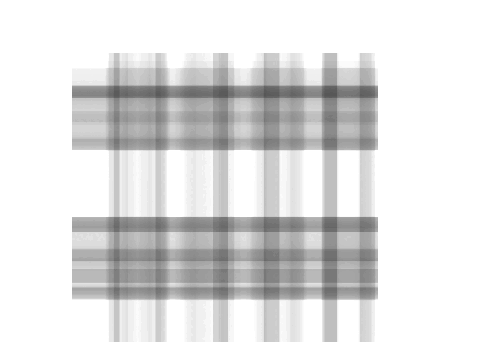

## University of Minnesota

Instructor, 2025--27 -- [MATH 5485](https://umtc.catalog.prod.coursedog.com/courses/0043011) (Fall 2025, Fall 2026) and [MATH 5486](https://umtc.catalog.prod.coursedog.com/courses/0134001) (Spring 2026)

```{=html}
<div class="course-grid">
  <div class="course-card" tabindex="0">
    
    <strong>Introduction to Numerical Methods I</strong><br>Fall 2025 &middot; Fall 2026
    <div class="course-options">
      <span>Choose a semester</span>
      <a href="https://jackrthomas.github.io/Math5485/">Fall 2026</a>
      <a href="https://jack.thomaslabs.co.uk/teaching/Math5485-Fall-2025/">Fall 2025</a>
    </div>
  </div>
  <a class="course-card" href="https://jack.thomaslabs.co.uk/teaching/Math5486-Spring-2026/">
    
    <strong>Introduction to Numerical Methods II</strong><br>Spring 2026
  </a>
</div>
<script>
// Restart a card's GIF when the pointer (or focus, on phones) leaves it, so the
// next view plays from the beginning. Each restart uses a fresh blob: URL of the
// already-downloaded GIF, which browsers treat as a new image (no refetch).
document.querySelectorAll(".course-card").forEach(function (card) {
  var img = card.querySelector("img");
  var blobUrl = null, blob = null;
  fetch(img.src).then(function (r) { return r.blob(); }).then(function (b) { blob = b; });
  function restart() {
    if (!blob) return;
    var next = URL.createObjectURL(blob);
    img.src = next;
    if (blobUrl) URL.revokeObjectURL(blobUrl);
    blobUrl = next;
  }
  card.addEventListener("mouseleave", restart);
  card.addEventListener("focusout", function (e) {
    if (!card.contains(e.relatedTarget)) restart();
  });
});
</script>
```

------------------------------------------------------------------------

## École nationale des ponts et chaussées, France {#France}

Class Teacher, 2023--25 -- [1AEDP Analysis of PDEs](http://gede.enpc.fr/Programme/fiche.aspx?param=M:1AEDP)\
[Led combined lectures and problem classes (of ≈20), marking weekly quizzes and exam scripts.]{.role-note}

- [Extra questions](teaching/notes/extras.pdf#page=6) (updated 2 December 2024)

## University of Warwick, UK

Supervisor, 2016--22\
[Led small groups (of 5 or 6) of first- and second-year undergraduates: advice and guidance on core modules, marking weekly assignments, and administrative tasks.]{.role-note}

| Year | Groups | Modules |
|:----|:--------------|:--------------|
| 2021/22 | 1st year: 2 groups (Maths & Stats) | Sets & Numbers, Mathematical Analysis, Linear Algebra |
| 2019/20 | 1st year: 3 groups (Maths & Stats) + Mathematical Analysis marking (external students) | First-year core modules |
| 2018/19 | 1st year: 1 group (Discrete Maths)<br>2nd year: 2 groups (Mathematics) | Analysis III, Algebra I & II, Multivariable Calculus, Norms Metrics & Topologies |
| 2017/18 | 1st year: 1 group (MORSE, Data Science, Maths & Stats) + Mathematical Analysis marking | First-year core modules |
| 2016/17 | 1st year: 1 group (MORSE, Maths & Stats) | First-year core modules |
: {.teaching-table}

**Resources**

- [First Year Examples -- Term 1](teaching/warwick/1term1.pdf) (Sets and Numbers & Mathematical Analysis; updated 4 December 2019)
- [First Year Examples -- Term 2](teaching/warwick/1term2.pdf) (updated March 2019)
- [Linear Algebra -- vector space flashcards](teaching/warwick/linear_algebra_cards.pdf) (updated 19 January 2020)
- [Second Year Examples](https://www.overleaf.com/read/ytjhsvxmrzyb#f72cb9) (Analysis 3, Multivariable Calculus & Algebra 1)
- [Flashcards LaTeX Template](https://www.overleaf.com/read/nywmjxkvjwbp#70ff39) -- follow the instructions to create your own flashcards
